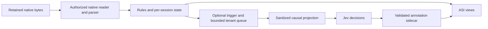

# Jev as a semantic preprocessor for Semon ASI

Experiment date: 2026-10-29. Source base: `893dd56fdc63fd53b7febd597c1381570c01f64b`. This is an isolated experiment; it changes no production parser, API, storage, runtime control, or mandatory dependency.

## Recommendation

**Do not make Jev a mandatory ASI dependency or enable broad production classification.** Keep native parsing and deterministic rules authoritative. Jev is inexpensive and faster than the tested lightweight LLM, but this projection/taxonomy does not consistently improve activity, anomaly, or phase detection. If pursued, use an optional asynchronous, event-triggered shadow pilot after improving input evidence and independently labeling complete, consented real sessions. This PoC ships no production integration.

## Experiment and evidence quality

The matrix has eight conditions: rules prefix/offline; Jev prefix per-event, microbatch, and event-triggered plus offline per-event; and Claude Haiku prefix/offline per-event. Each remote condition repeats the same 58 unique events three times. Repetition measures variability, not 174 independent examples. All 873 matrix requests completed without request failures; two probes add 48 calls. This does not establish an availability SLA.

The corpus contains 30 native CLI compatibility-fixture records captured with deterministic mock providers and 28 authored challenges, in 14 session groups. All native groups are incomplete excerpts. Only three authored sessions, totaling 22 events, are complete. These are sanitized native-format observations and synthetic challenges, not representative live user sessions. Labels are agent-authored weak references without human adjudication. The baseline and taxonomy were developed for this PoC; the authored challenge holdout is not an independent real-world test set.

Native bytes and source-line hashes remain unchanged. Two annotation audits corrected source-proven metadata/phase mistakes, preserving v1/v2 snapshots and a correction manifest. Final aggregates use v3 labels after checking saved native hashes; historical per-run summaries retain their original references. No labels were changed to improve model scores. The main input projection was frozen across conditions; a separate probe changes two allowlisted error fields only.

## Measured streaming classification

Accuracy against the causal streaming reference, pooled over repetitions:

| Strategy | Activity | Failure category | Retry/loop | Anomaly | Phase |
| --- | ---: | ---: | ---: | ---: | ---: |
| Rules | .603 | .914 | .897 | .948 | .534 |
| Jev per-event | .563 | .885 | .914 | .759 | .420 |
| Jev microbatch | .580 | .885 | .943 | .851 | .448 |
| Rules + triggered Jev | .678 | .914 | .931 | .805 | .569 |
| Haiku per-event | .718 | .960 | .983 | .925 | .529 |

Macro F1 across all taxonomy classes, including unsupported classes with zero scores:

| Strategy | Activity | Failure category | Retry/loop | Anomaly | Phase |
| --- | ---: | ---: | ---: | ---: | ---: |
| Rules | .439 | .453 | .729 | .686 | .444 |
| Jev per-event | .503 | .457 | .730 | .577 | .323 |
| Jev microbatch | .523 | .457 | .821 | .662 | .341 |
| Rules + triggered Jev | .531 | .487 | .765 | .616 | .492 |
| Haiku per-event | .664 | .645 | .930 | .770 | .436 |

Activity accuracy on native fixture excerpts is .667 rules, .389 Jev per-event, .633 triggered, and .567 Haiku; on authored challenges it is .536, .750, .726, and .881 respectively. The triggered aggregate gain comes from challenges, not improved native fixture activity. Failure-category accuracy is dominated by 49/58 events labeled `none`; several failure classes have one unique example.

Rare-positive precision/recall and transition scores expose errors hidden by accuracy:

| Strategy | Anomaly P/R | Retry P/R | Loop P/R | Phase boundary P/R/F1 |
| --- | --- | --- | --- | --- |
| Rules | .500/.333 | .286/1.000 | .667/1.000 | .522/.500/.511 |
| Jev per-event | .176/1.000 | .500/1.000 | .400/1.000 | .459/.389/.421 |
| Jev microbatch | .257/1.000 | .857/1.000 | .400/1.000 | .474/.375/.419 |
| Rules + triggered Jev | .209/1.000 | .500/1.000 | .500/1.000 | .565/.542/.553 |
| Haiku per-event | .409/1.000 | .667/1.000 | 1.000/1.000 | .673/.514/.583 |

There are only three anomaly-positive, two retry, and two loop events. A boundary is any phase change between adjacent selected same-session rows, including `unknown`; it does not measure physical process transitions or omitted records. Rules have 44 adjacent pairs; remote trials repeat those pairs three times. Valid prediction coverage is 100% in these runs. Invalid/missing answers would count as abstentions and false negatives. Full per-class precision/recall, confusion matrices, and harness/origin/split strata are in [comparison.json](results/comparison.json).

Repeated labels changed in 11/290 event-dimension pairs for Jev per-event, 8/290 microbatch, 3/290 triggered, and 12/290 Haiku prefix. Triggered stability includes rules-handled events. Probabilities are retained; calibration and seed-controlled determinism are unverified. The validator checks ranges and keys, not normalization or agreement with the declared winning class.

## Scheduling, latency, throughput, and cost

| Streaming strategy | Calls | HTTP P50/P95 ms | Sequential events/s | Estimated Jev input cost |
| --- | ---: | ---: | ---: | ---: |
| Rules | 0 | n/a | 12,339 | $0 |
| Jev per-event | 174 | 495.9/556.9 | 2.01 | $0.011645 |
| Jev microbatch | 93 | 503.2/682.2 | 3.48 | $0.014382 |
| Rules + triggered Jev | 84 | 500.4/617.6 | 4.09 | $0.005608 |
| Haiku per-event | 174 | 4180.8/6644.1 | .23 | unknown |

Rules compute P50/P95 was about .028/.083 ms in CI. Its tiny replay throughput is not a service-capacity test. Remote throughput includes sequential network waits and excludes simulated arrival sleeps. HTTP percentiles include gateway/network time, not direct TypeSafe inference alone. Responses resolved to `jev-1.14.0` and `claude-haiku-5-5` through Magpie.

Microbatches hold at most four same-session events for a timestamp-derived 500 ms window. Projected arrival-to-label P50/P95 was 903.6/1123.8 ms; three repeated event rows lacked timestamps and have unknown queue wait. This is a logical delay estimate, not a wall-clock stream replay. Each target gets a causal prefix in independent Jev questions. Duplicated context increased input tokens from 277,257 per-event to 342,423 microbatch: fewer calls did not mean lower cost. Prefix LLM microbatch is rejected because a shared chat prompt cannot isolate sibling targets.

The trigger sends 28/58 events (48.3%) to Jev: 84 calls over three repetitions versus 174 per-event. Its 133,515 input tokens reduce estimated cost about 52%. Gate compute P50/P95 was .019/.055 ms. The mixed event P50 is near zero because most events use rules; model-served events still wait about half a second.

A separate 36-call burst probe, 12 calls at each concurrency, measured 2.05, 4.05, and 7.23 requests/s at concurrency 1, 2, and 4. RTT P50/P95 was 484/547, 478/556, and 515/582 ms, without HTTP errors. It repeatedly queried two fixture events; caching, sustained load, tenant contention, rate limits, and outage behavior remain unqualified.

Jev estimates use returned input usage at the published direct rate of $0.042/million input tokens, with free output. They are not confirmed Magpie bills. Haiku usage is retained (prefix 190,263 input/39,542 output; offline 220,632/40,897), but gateway pricing units were not established, so billed cost is unknown. Superseded/smoke calls also incurred usage; an interrupted initial Haiku offline attempt retained none, so complete billed experiment expenditure is unknown.

## Streaming versus offline

Offline preserves chronological target position and exposes all selected session rows under the same context cap. Both views below use the same offline reference. Full native-session accuracy cannot be inferred from excerpts; only the authored subset contains complete sessions.

| Model/view | Activity | Failure | Retry | Anomaly | Phase |
| --- | ---: | ---: | ---: | ---: | ---: |
| Jev prefix | .563 | .885 | .914 | .759 | .408 |
| Jev offline | .534 | .862 | .862 | .782 | .437 |
| Haiku prefix | .718 | .960 | .983 | .925 | .609 |
| Haiku offline | .770 | .960 | .966 | .914 | .701 |

Across 174 paired event-trials, Jev offline makes 14 phase predictions correct that prefix misses and loses 9 prefix-correct predictions. For retry it gains none and loses 9: earlier events inherit later loop context. Haiku offline gains 22 phase predictions and loses 6. Jev offline RTT P50/P95 was 505.5/569.5 ms; Haiku offline was 3998.7/6255.3 ms.

On the 22 complete authored events × three trials, Jev offline loses 7 prefix-correct activity predictions and gains 3, loses 9 retry predictions and gains none, and gains 5 phase predictions while losing 4. Haiku phase accuracy on this subset rises from .773 to .848 against the same offline reference, but activity falls .909 to .894 and retry .955 to .909. More context helps some phase judgments while hurting target attribution. These are synthetic-only results. The aggregate separates complete authored metrics and paired counts. Rules predictions are unchanged across views; different phase scores arise solely from reference differences.

An initial offline formatter incorrectly relocated the target after its context. Its Jev run is archived in `evidence/initial-offline/`, excluded from the matrix, and replaced by `ordered-20261029` runs. The initial Haiku offline client was interrupted before outputs and is unscored. Both annotation rounds and the formatter correction remain auditable.

## Failure cases and attribution

- **Missing error evidence:** the main projection omits Codex `payload.reason` and `payload.error.message`. Jev calls both authored model/transport aborts `unknown`. In the 12-call projection probe, adding only these fields changes all six enriched predictions to `transport`: it recovers transport but still misclassifies the model example. The former is missing information; the latter remains taxonomy/model ambiguity. Main inputs and raw data stay unchanged.
- **Completion versus session end:** fixture acknowledgements such as `SYNTHETIC_CLAUDE_ACK` have little semantic content. The projection omits Claude `message.stop_reason`; some completion annotations depend on native evidence unavailable to classifiers. Neither a turn stop nor an excerpt's last row proves session termination. Preserve native outcomes and `unknown` phases.
- **Future context:** ordered offline Jev changes early retry-sequence events to `loop`, reducing retry recall to zero. Correct target position alone does not solve target attribution.
- **False anomaly alerts:** per-event Jev finds all three unique anomalies but has .176 precision, versus rules .500 precision/.333 recall. This does not justify autonomous incident creation.
- **Reference defects:** resumed Claude metadata initially had conversational labels, and fixture turn ends had session-ending labels. Source-contract review corrected these independently of model outcomes. Recovery/activity overlaps remain weak-label ambiguities.

[failure-cases.jsonl](results/failure-cases.jsonl) records every disagreement, repetition, expected/predicted value, and retained validated answer. Disagreement with a weak reference is not automatically a model error.

## Integration architecture

Jev is a decision-only service: shared `state` plus a question-ID map returns typed `choice`, `noul`, `score`, or `box` answers. This experiment exercised multiple choice questions and `noul` anomaly probabilities, not score/image inference. The tested route is `POST https://magpie.onsager.ai/v1/systemone` with `typesafe/jev-latest`. There is no text generation, tool calling, durable session memory, or documented token-streaming API. Real-time classification therefore means repeated synchronous HTTP decisions over a causal event stream. Default limits are 64k tokens per request and 32k per question; 262k requires an explicit danger-zone header. Our contexts are capped at 8,192 UTF-8 bytes. Rate limits are account-specific. See [dated primary-source API, pricing, and privacy research](jev-research.md) and the retained OpenAPI snapshot.

If the benchmark justifies a further pilot, put classification in an optional asynchronous ASI consumer after authorized native ingestion and parsing. Keep native event kinds, identity, lineage, source generation, byte boundaries, and parser-derived outcomes authoritative. A label is a revisable annotation, never a replacement for a native event or evidence of process liveness, user approval, completion, or permission to act.

The input should be a bounded projection: supported native event kind, selected visible text, sanitized tool name/command identity, result status, and a short causal session window. Keep credentials, environment variables, system prompts, unrestricted tool arguments, private paths, attachments, and raw log bytes outside the provider request. The fixture-only allowlist in this experiment is not a production sanitizer.

An annotation key should bind the tenant and authorized source identity, generation, consumed record/range hash, parser version, classifier model version, taxonomy/prompt version, and context policy. Store input evidence references and confidence beside the label. Changed source bytes invalidate dependent annotations. Native collection and rendering must work when the classifier is disabled or unavailable; classification must not sit inside a source/Catalog publication transaction or extend an authorized source-reader lifetime.

For a pilot, prefer deterministic native parsing and cheap rules first, with Jev only on selected uncertain semantic events. Keep retry detection and phase state per session in caller code; Jev has no durable session memory. Record distinctions between a tool failure, a recovered failure, a model failure, and unavailable evidence. Low confidence and invalid responses become unknown annotations; the reported probabilities have not been calibrated for ASI.

## Scale and reliability

Use bounded queues and per-tenant request/token budgets. A batch must keep event targets and causal context separate; it must not mix tenant data in shared state. Jev questions are independent, so dependent judgments such as failure → retry → phase must be composed in application state rather than relying on answer order. Record queue delay separately from HTTP latency and reject stale-generation results before publication.

Native capture must continue during timeouts, malformed model responses, provider outages, or rate limiting. Keep unavailable classification explicit and observable, with no automatic provider switch or replay of native operations. A future background classifier may retry an idempotent annotation request under a separately chosen bounded policy; this experiment performs no automatic request retries. Measured sequential replay throughput is not a provider capacity or multi-tenant scaling qualification. Account-specific RPS/TPS limits, burst behavior, cancellation, and outage recovery require a later load test.

CI exercises mocked timeout/abstention accounting and request validation; the successful remote trials do not exercise a real provider outage. Before a pilot decision, fix and freeze the evidence projection, obtain independent labels for complete native sessions, and predeclare class-specific precision/recall and latency goals at an acceptable alert budget. Require improvement over native/rules baselines on that held-out set; this sample does not establish it.

## Privacy

Only checked-in sanitized native fixtures and explicitly synthetic challenge records are eligible for this experiment. No private live session logs are sent. Original repository fixture files remain unchanged. Extracted text is still content sent to the remote service; omitting the raw JSON envelope does not make a request content-free.

The measured path uses an existing Magpie gateway and the configured TypeSafe or LLM provider. Gateway processing and retention are an additional boundary. TypeSafe says it does not train on customer content; public terms do not establish a fixed request retention period, default ZDR, or regional processing selection. The privacy policy describes U.S. hosting. Sensitive session content needs explicit product consent, a production redaction policy, tenant custody controls, and verified provider/gateway contractual terms before an integration pilot. See [the primary-source research](jev-research.md).

## Reproduction and artifacts

See [README.md](README.md) for commands, [pipeline.md](pipeline.md) for source/pipeline provenance, [data](data/) for the corpus, and [results](results/) for individual predictions, probability distributions, request timing, usage, and errors. CPU-bound checks and deterministic throughput measurements run in GitHub Actions because host thermal telemetry is unavailable. Remote inference replay is network-bound and performs only bounded processing of this small sanitized corpus; it does not run a model locally.
